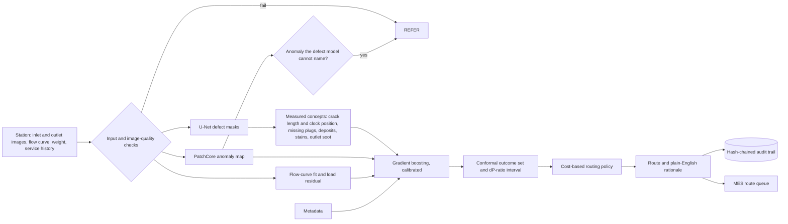

# dpf-preinspect

Vision pre-inspection and downstream-outcome prediction for used diesel particulate filters (DPFs) arriving at a cleaning and remanufacture line. A research prototype.

> **All data in this repository is synthetic, generated locally by a documented simulator.** The results below demonstrate the method; they are not evidence of real-world performance.

Built independently to explore the problem described in the Eminox–University of Lincoln KTP advert; not affiliated; synthetic data only.

## The problem

Today every used DPF receives a full thermal and pneumatic clean before a flow-restriction test and a filtration-integrity test decide PASS, REWORK (extended clean) or SCRAP. Units that end up scrapped have already used oven time, energy and labour. A pre-inspection station weighs each unit, images both faces and records an incoming flow curve. From those and the service history, this prototype predicts the downstream outcome and routes the unit before it is cleaned:

| Route | Meaning |
|---|---|
| PROCEED | standard clean, as today |
| EXTENDED_CLEAN | straight to the extended clean |
| QUARANTINE | scrap candidate; a person confirms (the system never scraps automatically) |
| REFER | inspector review: uncertain prediction, unrecognised anomaly or invalid input |

## Approach



The deployed path is the interpretable **concept route**: a U-Net turns images into physical measurements, which are fused with flow and metadata by gradient boosting. An end-to-end multi-modal network is trained alongside it as a challenger. See `docs/technical_report.md` for the method and `docs/system_design.md` for the architecture.

## Key results

Profile `demo`, run `20261023-062255_demo` (code `60efad0ef1`, data manifest `93ee938bc98e`, generator v1.0). Test split, scored against the simulator's true outcome after probability calibration. The operating-point columns apply the same cost-based threshold search, under the same wrongful-scrap cap, to every row.

| Approach | Macro-F1 | SCRAP recall | Wrongful scrap at operating point | REFER share at operating point | ΔP-ratio MAE | ECE |
|---|---|---|---|---|---|---|
| Metadata only | 0.521 | 0.339 | 0.5 % | 37.0 % | 0.074 | 0.103 |
| Flow only | 0.398 | 0.034 | 0.5 % | 3.5 % | 0.077 | 0.075 |
| Classical vision | 0.487 | 0.610 | 5.6 % | 16.1 % | 0.096 | 0.064 |
| Classical vision + flow + metadata | 0.629 | 0.508 | 1.5 % | 29.9 % | 0.067 | 0.059 |
| Learned concepts | 0.454 | 0.610 | 2.6 % | 17.7 % | 0.098 | 0.063 |
| Learned concepts + flow + metadata | 0.649 | 0.508 | 1.5 % | 18.9 % | 0.066 | 0.054 |
| End-to-end image only | 0.513 | 0.610 | 3.1 % | 16.5 % | 0.117 | 0.106 |
| End-to-end all modalities | 0.527 | 0.220 | 2.1 % | 16.9 % | 0.078 | 0.094 |

- Highest macro-F1: **Learned concepts + flow + metadata** (0.649). Combining vision, flow and metadata in the concept route adds 0.129 macro-F1 over the best single modality (metadata).

- At the operating point, the deployed model (learned_flow_meta) routes 59.3 % of true scrap to QUARANTINE or REFER, quarantines 1.5 % of serviceable units, and refers 18.9 % of units to an inspector. Expected saving under the assumed costs: 9.94 GBP per unit against today's process.
- Trade-off (calibration data): the cost-optimal policy captures 68.8 % of scrap while referring 17.6 %; catching 90 % or more within the wrongful-scrap cap would mean referring 87.6 % of units at an expected 103.64 GBP per unit instead of 82.47.

Acceptance tests ([plan](docs/acceptance_test_plan.md); illustrative targets in `configs/acceptance.yaml`; full evidence in [reports/validation_report.md](reports/validation_report.md)):

| ID | Criterion | Target | Measured | Result |
|---|---|---|---|---|
| AC-01 | Wrongful-scrap rate | <= 0.020 | 0.015 | PASS |
| AC-02 | SCRAP capture | >= 0.900 | 0.593 | FAIL |
| AC-03 | p95 latency | <= 2.000 | 0.655 | PASS |
| AC-04 | Decision repeatability | >= 0.900 | 0.809 | FAIL |
| AC-05 | Conformal coverage | >= 0.870 | 0.913 | PASS |
| AC-06 | Graceful degradation | <= 0.100 | 0.075 | PASS |
| AC-07 | Audit-trail integrity | == yes | yes | PASS |
| AC-08 | Inspector workload | <= 0.350 | 0.189 | PASS |

Line simulation (5 replications, assumed rates and costs): oven hours 10681 → 9209, energy 81883 → 71756 kWh, mean lead time 11.9 → 9.8 h, over 20 simulated days.

The **full profile** (`make full`, run `20261023-064502_full`) completed end to end in 106 minutes. Its best macro-F1 is 0.692 (Learned concepts + flow + metadata), and it passes 5 of 8 acceptance criteria (not met: AC-01, AC-02, AC-04). Its own reports are produced by `make full` and are not committed.

## Quickstart

```bash
make setup     # virtual environment and dependencies (uses uv when installed)
make demo      # data -> models -> evaluation -> validation -> simulation -> reports -> API smoke test
make api       # then, in a second terminal: make app   (optionally: make replay)
```

`make test` runs the test suite on the tiny profile; `make full` repeats the pipeline at full scale. Measured stage times for this run: train 527 s; evaluate 22 s; validate 288 s; simulate 2 s; report 0 s; data 44 s; total 884 s. They were taken on an 8 GB Apple M2 under heavy memory pressure from other applications; see `docs/project_plan.md` for the budget discussion.

## Repository map

| Path | Contents |
|---|---|
| `src/preinspect/synth/` | virtual inspection cell: population, flow bench, outcome model, scenes, renderer, faults, inspectors |
| `src/preinspect/data/` | validation gate, data card statistics, datasets |
| `src/preinspect/classical/` | substrate localisation, lattice estimation, cell states, classical concepts |
| `src/preinspect/models/` | U-Net, PatchCore, fusion network, boosting, calibration, cross-fitted vision |
| `src/preinspect/explain/` | Grad-CAM, Integrated Gradients, SHAP and tests against ground truth |
| `src/preinspect/decision/` | conformal prediction, cost model, routing policy, rationale templates |
| `src/preinspect/validation/` | robustness, domain shift, MSA, DoE, latency, acceptance |
| `src/preinspect/service/` | inspection pipeline, FastAPI, audit trail, MES adapter, monitoring, replay |
| `src/preinspect/app/` | Streamlit decision-support UI |
| `src/preinspect/sim/` | SimPy line model and sensitivity analysis |
| `src/preinspect/report/` | Jinja2 templates and rendering of every result-bearing document |
| `configs/` | profiles, costs, acceptance criteria, line simulation |
| `docs/` | domain primer, design, technical report, risk, plan, training, cards, decisions, FAQ |
| `reports/` | rendered validation and data-quality reports, figures |

## Objectives and evidence

| KTP objective | Evidence in this repository |
|---|---|
| Machine vision that detects and classifies defects | U-Net segmentation with per-class Dice, IoU and AUROC; classical image-processing baseline; anomaly guard for unseen defects (`docs/technical_report.md`) |
| AI integrated with the process for real-time decision support | Inspection API, Streamlit station UI, MES route queue, latency benchmark (`docs/system_design.md`) |
| Validation and optimisation under industrial conditions | Robustness, domain shift and commissioning, MSA, imaging DoE, acceptance tests (`reports/validation_report.md`) |
| Reducing unnecessary downstream processing and cost | Cost-based routing policy and line simulation with sensitivity analysis |
| Embedding through knowledge transfer | Training manual, demo script, FAQ, model and data cards (`docs/`) |
| Project planning, risk assessment, research output | `docs/project_plan.md`, `docs/risk_assessment.md`, `docs/technical_report.md`, `docs/decisions.md` |

## Limitations

- The data is synthetic. The simulator encodes assumptions written down in `docs/domain_primer.md`; a model can only learn those assumptions. Real-world performance is unknown until real data is collected (`docs/real_data_plan.md`).
- Faces are stylised with about 30 to 50 cells across; a real station needs higher resolution or tiled inference.
- Costs, energy figures and line capacities are assumptions for illustration.

## Licence

MIT, see `LICENSE`. Copyright Noyal George.
