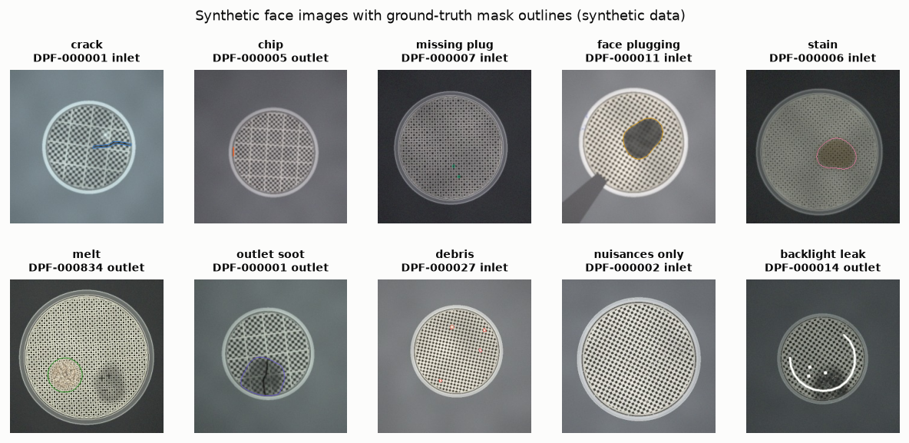

# Data card: synthetic DPF pre-inspection dataset

> **Synthetic data, generated locally.** Every unit, image, flow curve and label below comes from the virtual inspection cell in `src/preinspect/synth/`. It demonstrates methods; it says nothing about the real-world prevalence of defects or the performance of any real system.

Rendered from `data/demo/stats.json` (profile `demo`, generator v1.0, seed 20261023). Regenerate with `make data CONFIG=demo`.

## Purpose

Training and evaluating a pre-inspection system that predicts the downstream cleaning outcome (PASS, REWORK, SCRAP) of used diesel particulate filters from two face images, an incoming flow-bench curve and service metadata. The physical assumptions are in `docs/domain_primer.md`.

## Composition

- Units: 1,300; records after fault injection: 1,308 (duplicate bookings add records).
- Records accepted by the validation gate: 1,185; quarantined: 123; temperature fields blanked: 39.
- Files: 5,206, each listed with its SHA-256 in `manifest.json`. Images 52.7 MB, masks 1.6 MB.

### Recorded disposition by split (accepted records)

| Split | PASS | REWORK | SCRAP |
|---|---|---|---|
| calib | 67 | 38 | 48 |
| novel | 0 | 0 | 53 |
| shift | 52 | 38 | 36 |
| test | 117 | 71 | 66 |
| train | 291 | 156 | 152 |

- **train / calib / test**: one population split chronologically by arrival date, with no unit in more than one split.
- **novel**: units with thermal melt, a defect class that appears nowhere else. They arrive during the test period and test the anomaly guard.
- **shift**: a later product line with an unseen cell density imaged by a different camera profile. It is used for the domain-shift and commissioning study.

## Modalities

| Modality | Content |
|---|---|
| Face images | Inlet and outlet faces, 256 x 256 px RGB JPEG. Lighting mix (inlet): diffuse 544, low_angle 428, backlight 213. |
| Defect masks | Per-pixel bitmask, one bit per class: crack, chip, missing plug, face plugging, stain, melt, outlet soot, debris. |
| Flow curve | Pressure drop (kPa) at 8 flow rates (m³/s), with occasional sensor dropouts. |
| Metadata | Material, cell density (cpsi; 1 cpsi = 0.155 cells/cm²), diameter and length (mm), application, operating hours, active-regeneration count, maximum regeneration temperature (°C, missing on 40.3 % of accepted records), weight gain (g), previous cleans. |
| Labels | Recorded downstream results: post-clean ΔP ratio, integrity pass/fail, disposition. |
| Latent truth | Soot and ash load, glazing, internal cracks, bypass fraction and true outcome. Used for evaluation and explanation tests only, never as a model input. |

## Defects and nuisances

Units with at least one visible instance of each class (accepted records):

| Split | crack | chip | missing plug | face plugging | stain | melt | outlet soot | debris | 
|---|---|---|---|---|---|---|---|---|
| calib | 18 | 17 | 48 | 44 | 21 | 0 | 28 | 10 | 
| novel | 21 | 9 | 52 | 15 | 11 | 53 | 36 | 5 | 
| shift | 13 | 13 | 37 | 29 | 18 | 0 | 21 | 6 | 
| test | 25 | 26 | 83 | 74 | 43 | 0 | 37 | 16 | 
| train | 65 | 66 | 199 | 172 | 99 | 0 | 80 | 34 | 

- Share of accepted units with no visible defect: 29.8 %. These units feed the anomaly guard's memory bank.
- Nuisances that must not be called defects, counted over all images: dust 910, marker ink 404, specular reflections 682, clamp occlusion 391. Lighting gradients, exposure, white balance, noise, blur and seating offset vary on every image.

## Data-quality faults (injected on purpose)

| Fault | Injected | Caught by check |
|---|---|---|
| duplicate_id | 8 | `DUPLICATE_ID` (16 records flagged) |
| label_flip | 39 | `DISPOSITION_MISMATCH` (39 records flagged) |
| missing_value | 26 | `MISSING_REQUIRED` (26 records flagged) |
| out_of_range | 13 | `OUT_OF_RANGE` (13 records flagged) |
| unit_mixup_f | 16 | `PROBABLE_FAHRENHEIT` (39 records flagged) |
| sensor dropouts (more than 2 points) | from the flow simulator | `FLOW_DROPOUTS` (32 records flagged) |

Flagged counts can exceed injected counts. A duplicate booking flags both records, and a genuine extreme regeneration temperature is indistinguishable from a Fahrenheit slip, so its field is also blanked.

## Label quality

- Recorded dispositions disagree with the latent true outcome on 6.2 % of accepted records. This is downstream test noise near the specification limit; it is irreducible and cannot be detected from the record. Headline metrics use the true outcome; training uses the recorded label.
- Three simulated inspectors label 47 test units twice each for the measurement system analysis:
  - Inspector A: misses hairline cracks.
  - Inspector B: over-rejects stains.
  - Inspector C: drifts late in a shift.

## Simplifications and intended use

- Faces have about 30 to 50 cells across, not the 150 to 250 of a real filter; see the resolution budget in `docs/system_design.md`.
- Relationships between latent condition and observations are monotone surrogates with parameters chosen for plausibility, not fitted to field data.
- Intended use: method development, testing, teaching and demonstration. Not for estimating real defect rates, costs or savings.

Generation time for this profile: 128.7 s (4 worker processes).
