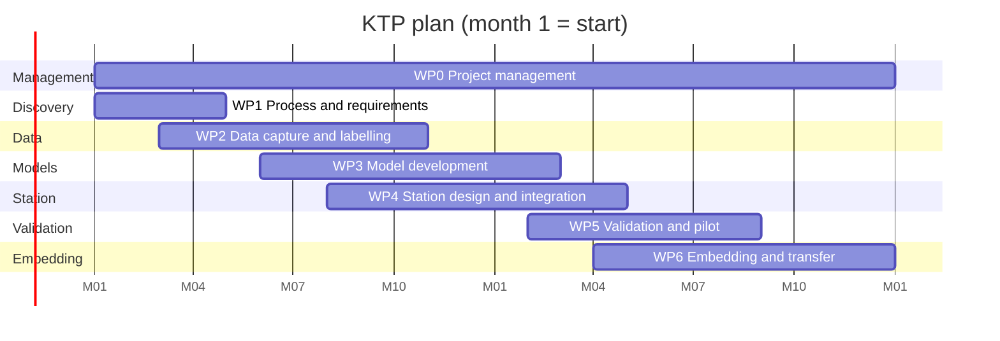

# Project plan

A 24-month Knowledge Transfer Partnership plan for taking AI-based pre-inspection of used DPFs from this prototype to an embedded, validated system on the cleaning line, followed by the prototype's own delivery log.

## 1. Aim and outcomes

**Aim.** A pre-inspection system at the cleaning line that predicts each unit's downstream outcome from images, flow and service data, routes it before cleaning, and is trusted, validated and maintained by the company's own staff.

**Outcomes by month 24.**
1. A validated station in daily use on agreed routes, with a documented decision policy and acceptance evidence.
2. Reduced unnecessary processing (scrap units identified before cleaning, heavily loaded units sent straight to extended clean) measured against a baseline.
3. Company staff able to operate, monitor, retrain and extend the system.
4. Research output: at least one paper and a technical report.

## 2. Work packages

| WP | Title | Months | Lead | Main tasks |
|---|---|---|---|---|
| WP0 | Induction and project management | 1 to 24 | Associate | Induction, KTP reporting, steering meetings, risk register, change control |
| WP1 | Process understanding and requirements | 1 to 4 | Associate | Process mapping, cost and time baselining, failure-mode review with inspectors, data audit of existing records, acceptance criteria workshop |
| WP2 | Data capture and labelling | 3 to 10 | Associate | Temporary imaging rig, capture protocol, labelling guide, labelled dataset, inter-rater MSA study, data card |
| WP3 | Model development | 6 to 14 | Associate with academic supervisor | Perception and anomaly models on real data, concept route, calibration, conformal sets, explanations and their tests, simulator re-parameterised from real data |
| WP4 | Station design and integration | 8 to 16 | Associate with maintenance and IT/OT | Station hardware (camera, lighting, cradle, enclosure), edge deployment, MES/PLC integration, operator UI, audit trail |
| WP5 | Validation and pilot | 14 to 20 | Associate with quality | Imaging DoE on the real station, gauge R&R, shadow-mode pilot, assisted mode, acceptance tests, risk assessment update |
| WP6 | Embedding and knowledge transfer | 16 to 24 | Associate with company supervisor | Training for operators and engineers, MLOps hand-over, documentation, live mode on agreed routes, final report, papers |

## 3. Milestones and deliverables

| Month | Milestone | Deliverables |
|---|---|---|
| 3 | Requirements signed off | Process map, cost baseline, acceptance criteria, data audit report |
| 6 | First real data | Temporary rig, capture protocol, first few hundred units captured |
| 10 | Labelled dataset and human baseline | Labelled dataset, labelling guide, inter-rater (attribute agreement) study, data card |
| 12 | Models on real data | Perception and outcome models, validation against held-out real data, model card |
| 14 | Station design frozen | Station design, BOM, H&S risk assessment reviewed by a competent person |
| 16 | Station integrated | Station on the line, MES integration, UI, audit trail |
| 18 | Shadow-mode results | Shadow-mode report against downstream outcomes |
| 20 | Acceptance tests passed | Validation report with gauge R&R, DoE, robustness and acceptance evidence |
| 22 | Live on agreed routes | Live operation for agreed routes, monitoring dashboard, MLOps procedure |
| 24 | Close and hand-over | Final KTP report, training records, technical report, paper submission |

## 4. Gantt chart

The calendar dates in the chart are placeholders for "month 1 = start"; only relative timing is meaningful.

## 5. Stakeholders (RACI)

R = responsible, A = accountable, C = consulted, I = informed.

| Activity | Associate | Academic supervisor | Company supervisor | Operators | Quality | Maintenance | IT/OT | H&S | KTP adviser |
|---|---|---|---|---|---|---|---|---|---|
| Requirements and acceptance criteria | R | C | A | C | C | I | C | I | I |
| Data capture and labelling | R | C | A | C | C | I | I | C | I |
| Model development | R | A | C | I | C | I | I | I | I |
| Station hardware | R | C | A | C | I | C | C | C | I |
| IT/OT integration | R | I | A | I | I | C | C | I | I |
| H&S risk assessment | C | I | A | C | I | C | I | R | I |
| Validation and pilot | R | C | A | C | C | I | I | I | I |
| Training and documentation | R | C | A | C | C | C | I | I | I |
| KTP reporting | R | C | A | I | I | I | I | I | C |

## 6. Resource plan

- **People.** The associate full-time; academic supervision about half a day a week; company supervisor about one day a week; inspectors' time for the inter-rater study and labelling reviews; maintenance and IT/OT support during WP4.
- **Equipment.** Temporary capture rig (WP2), then the station (WP4); an edge PC; a workstation with a GPU for training; storage for images.
- **Budget categories** (to be confirmed with the company): station hardware, compute, travel and conferences, training courses, publication costs.

## 7. Key performance indicators

| KPI | Measured from |
|---|---|
| Share of scrap units identified before cleaning | Downstream test results joined to station decisions |
| Oven hours and energy avoided | Line records against the baseline from WP1 |
| Wrongful-scrap rate (released quarantines) | Quarantine confirmation records |
| REFER share and override rate | Audit trail |
| Inspector agreement with the system | MSA studies |
| Knowledge transfer | Staff trained, procedures adopted, retraining performed by company staff |
| Research output | Papers, technical report, conference presentations |

## 8. Prototype delivery log

This repository is the proof of concept that precedes the plan above. Results are not quoted here; they are in the rendered reports.

| Date | Phase | Work done | Issues | Next |
|---|---|---|---|---|
| 2026-10-23 | 0 Scaffold | Package layout, CLI, configs (profiles, costs, acceptance, line simulation), run folders with provenance, CI, licence. | pyenv Python lacked `_lzma`; switched to uv-managed Python (ADR-001). | Domain primer, synthetic generator. |
| 2026-10-23 | 1 Synthetic data | Domain primer; virtual inspection cell (population, flow bench, outcome model, scene sampler, renderer with three lighting modes, camera profiles, faults, simulated inspectors); SHA-256 manifest; validation gate with record- and field-level quarantine; data card and gallery; generator v1.0 frozen. | Ambiguous Fahrenheit readings were quarantining genuine extreme units (ADR-008); rounding made one record self-inconsistent (fixed by deciding on recorded values). Generation time varies with memory pressure on the development laptop. | Classical image-processing baseline. |
| 2026-10-23 | 2 Classical baseline | Texture-based substrate localisation; FFT lattice estimation with sub-bin peak interpolation; per-cell missing and blocked classification; notch-filtered ridge detection; polar perimeter deviation; LAB colour statistics; flow-curve fitting; boosting baselines per modality. | Low-angle light made the wall grid the dominant spectral peak (ADR-011); cracks and soot were miscounted as missing plugs until excluded; cell-scale radial smoothing erased chips. | Deep learning. |
| 2026-10-23 | 3 Deep learning | Cross-fitted U-Nets and PatchCore banks; learned concepts; unexplained-anomaly guard; concept-route boosting and modality ablation; end-to-end gated fusion network; calibration with method chosen by cross-validation; headline table. | Training ran far slower than the benchmark under memory pressure; batch and crop sizes reduced (ADR-014). Captum's integration path over images exhausted memory; image embedding now fixed during IG. | Explainability and decisions. |
| 2026-10-23 | 4 XAI and decisions | Grad-CAM, IG and SHAP with tests against ground truth (energy in mask, pointing game, deletion and insertion, randomisation check, driver rank agreement); APS conformal sets and ΔP intervals; cost model; routing policy with wrongful-scrap cap and minimum capture; template rationale. | Off-by-one in APS set construction gave near-full sets (fixed and tested). REFER-on-ambiguity at a fixed alpha referred almost every unit; the routing alpha is now chosen by the cost search (ADR-016). | Validation campaign. |
| 2026-10-23 | 5 Validation | Shared inspection pipeline; robustness at five severities; domain shift and commissioning; attribute agreement and gauge R&R; imaging DoE; latency and ONNX export; acceptance tests and validation report. | Opaque occlusions were read as deposits; added an image-quality gate fitted on training images (ADR-017). | Service and UI. |
| 2026-10-23 | 6 Service | FastAPI service, hash-chained audit trail, mock MES route queue, monitoring (PSI, p-chart, calibration over time), replay, Streamlit station and dashboard pages, smoke test. | None blocking. | Line simulation. |
| 2026-10-23 | 7 Simulation | SimPy line model with baseline and gated scenarios, conservation test, tornado sensitivity. | Unit identity keys collided in the first version (fixed with a counter). | Documentation. |
| 2026-10-23 | 8 Documentation | README, technical report, model and data cards, system design with resolution budget and station schematic, risk assessment, training manual, FAQ, demo script, real-data plan, all result-bearing documents rendered from run outputs. | None blocking. | Full-profile run; stretch goals. |
