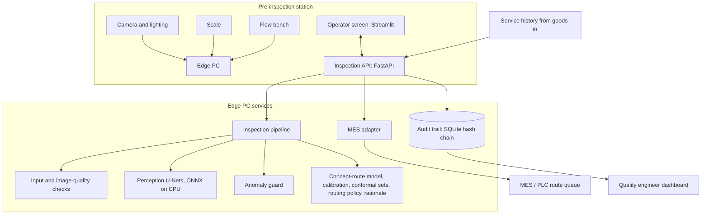
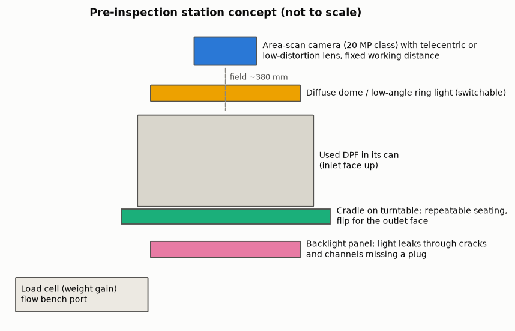
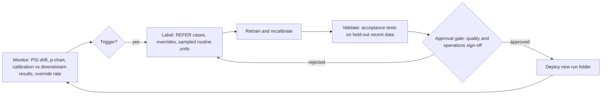

# System design

*Rendered on 2026-10-23 from configuration and run `20261023-062255_demo`. Station sizing figures are assumptions for supplier discussions, not specifications.*

## 1. Architecture

**Data flow per unit.** Goods-in record (part number, service history) → weight and flow curve → two face images → input and image-quality checks → perception and anomaly maps → concepts → calibrated outcome probabilities, conformal set and ΔP interval → routing policy → route, rationale and overlays to the operator → operator accepts or overrides → audit record (input hash, model and data versions, outputs, decision) → route published to the line → downstream test result logged later for monitoring.

## 2. Imaging station concept

- **Views.** Inlet face, then outlet face after turning the unit over in a cradle that seats it repeatably (centring stops, turntable for rotation).
- **Lighting.** A switchable diffuse dome or low-angle ring light for deposits, stains and chips, and a backlight panel for cracks and channels missing a plug, which show as light leaks. The imaging DoE recommends diffuse lighting at -0.4 EV and 256 px among the settings tested.
- **Camera.** Area-scan, fixed working distance, low-distortion or telecentric lens; enclosure to exclude ambient light.
- **Scale and flow bench.** Weight gain against the part's nominal weight; incoming flow curve at 8 flow points.

### Resolution budget

Field of view 380 mm (largest substrate plus can and margin). Real cell pitch is 25.4/√cpsi mm. Wall thickness 0.3 mm and narrowest crack of interest 0.1 mm are assumptions to confirm per part.

| Sensor | Pixels across field | mm per pixel | px per wall | px per 0.1 mm crack | px per cell pitch (100 / 200 / 300 / 400 cpsi) | Tiles per face (512 px) | Walls resolved | Crack under front light | Crack under backlight |
|---|---|---|---|---|---|---|---|---|---|
| 5 MP | 2,048 | 0.186 | 1.62 | 0.54 | 13.7 / 9.7 / 7.9 / 6.8 | 25 | no | no | yes |
| 12 MP | 3,000 | 0.127 | 2.37 | 0.79 | 20.1 / 14.2 / 11.6 / 10.0 | 49 | yes | no | yes |
| 20 MP | 3,648 | 0.104 | 2.88 | 0.96 | 24.4 / 17.2 / 14.1 / 12.2 | 64 | yes | no | yes |
| 45 MP | 5,460 | 0.070 | 4.31 | 1.44 | 36.5 / 25.8 / 21.1 / 18.2 | 169 | yes | no | yes |

Requirements: at least 2.0 px per wall, at least 2.0 px across a crack under front light, and at least 0.5 px under backlight, where transmitted light makes sub-pixel cracks visible. The table shows why the design relies on backlight for cracks and missing plugs, and why a real station runs the perception model on tiles of the full-resolution face. The prototype instead renders stylised faces with 30 to 50 cells across at 256 px, which gives a similar number of pixels per cell to the larger sensors.

### Bill of materials (indicative)

| Item | Specification | Price |
|---|---|---|
| Area-scan camera | 12 to 20 MP, global shutter, GigE Vision or USB3 Vision | to be quoted |
| Lens | Fixed focal length or telecentric, field ≥ 380 mm, low distortion | to be quoted |
| Dome and low-angle ring light | Switchable, white LED, with controller | to be quoted |
| Backlight panel | Collimated LED, ≥ 350 mm square, sealed against ash dust | to be quoted |
| Cradle and turntable | Self-centring for 229 to 330 mm cans, repeatable rotation, lifting aid | to be quoted |
| Enclosure | Light-tight, interlocked door, extraction port | to be quoted |
| Scale | Load cell, resolution ≤ 5 g, capacity to suit the heaviest unit | to be quoted |
| Edge PC | x86 or ARM, 16 GB RAM, optional GPU, industrial rating | to be quoted |
| Operator screen | Touch screen, gloves usable | to be quoted |

## 3. Edge deployment

- The U-Nets are exported to ONNX and run with ONNX Runtime on CPU (largest output difference from PyTorch 0.000002); the gradient-boosting model and decision layer are light.
- Measured p95 latency per unit on CPU: 0.65 s. A station cycle is minutes long, so CPU inference is sufficient; a small GPU would allow tiled high-resolution inference.
- Models, thresholds and the image-quality reference ship as one versioned run folder with its provenance (code commit, data manifest hash).

## 4. MLOps loop

Triggers: PSI above 0.25 on any monitored input, a p-chart point outside its limits, a calibration gap, a rising override rate, a new product line, or a scheduled review.

## 5. Integration with line systems

The `MesAdapter` interface (`src/preinspect/service/mes.py`) has a mock implementation keeping a route queue in SQLite. A production adapter would publish the same information over OPC UA or MQTT:

| Information | OPC UA node (example) | MQTT topic (example) |
|---|---|---|
| Unit ID at station | `ns=2;s=PreInspect/Station1/UnitId` | `line1/preinspect/station1/unit` |
| Route recommendation | `ns=2;s=PreInspect/Station1/Route` | `line1/preinspect/station1/route` |
| Route confirmed by operator | `ns=2;s=PreInspect/Station1/RouteConfirmed` | `line1/preinspect/station1/route/confirmed` |
| Station status and fault | `ns=2;s=PreInspect/Station1/Status` | `line1/preinspect/station1/status` |
| Model version | `ns=2;s=PreInspect/Station1/ModelVersion` | `line1/preinspect/station1/model` |

The edge PC sits in the OT network zone. Only route and status leave the station; images stay on the station or on a managed store. The API has no external exposure.

## 6. Retargeting to a new-build line

The same pipeline could inspect bare substrates before canning: change `defect_classes` to manufacturing defects (cracks, chipped skin, plug voids, cell distortion), drop the flow-based loading features and service history from the model groups in `configs/`, and redefine the outcome as accept or reject against the substrate specification. The generator, validation gate, perception, anomaly guard, calibration, routing and audit trail are unchanged. This is not built.
