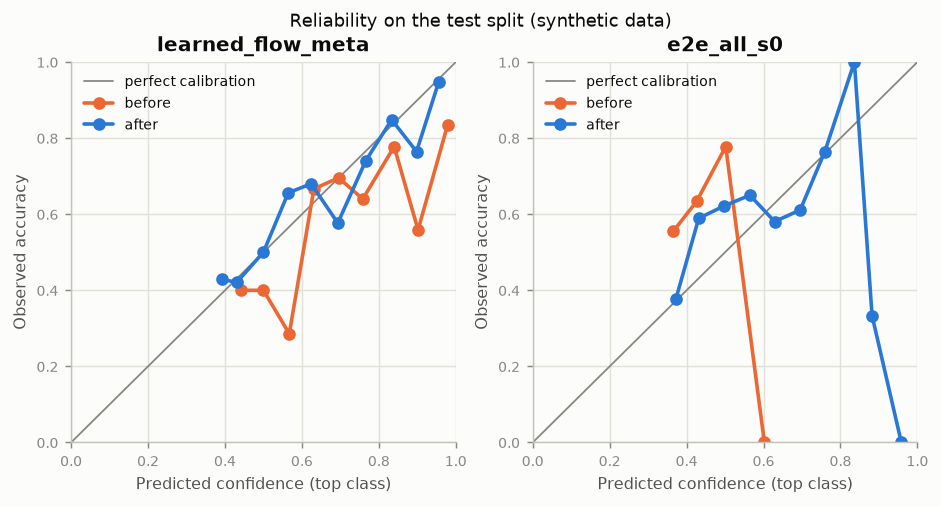
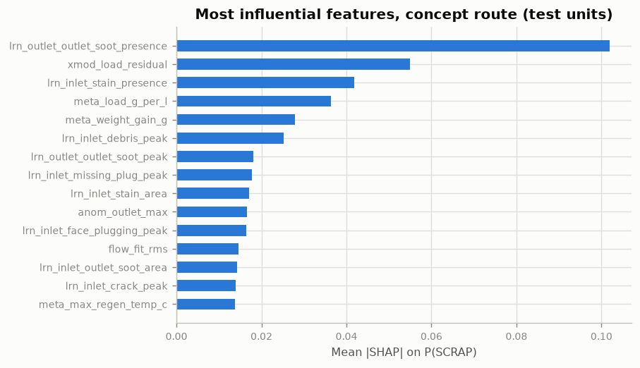
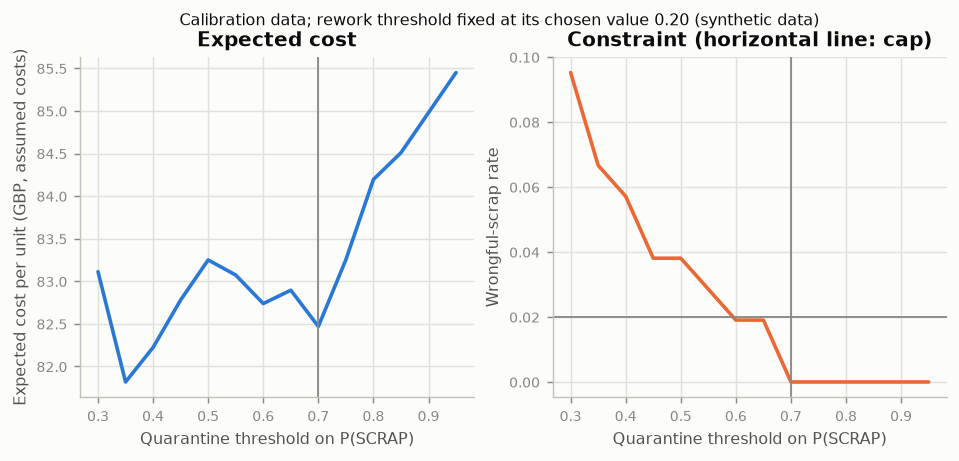
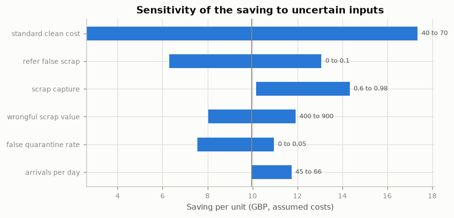

# Predicting the downstream outcome of used diesel particulate filters from images, flow and service history: a synthetic-data study

*Rendered from run `20261023-062255_demo` (profile `demo`, code `60efad0ef1`, data manifest `93ee938bc98e`) on 2026-10-23.*

> **All data is synthetic.** Every result below was produced on data from a documented simulator. It demonstrates the method and the validation approach; it is not an estimate of real-world performance.

## Abstract

Used diesel particulate filters (DPFs) are cleaned before tests decide whether they return to service, need an extended clean or are scrapped, so scrapped units consume cleaning capacity for nothing. We study a pre-inspection gate that predicts the downstream outcome before cleaning from two face images, an incoming flow-bench curve and service metadata. A simulator generates 1,300 units with partial observability by design: some failure modes are visible only in images, some only in flow, and some (internal cracks) only indirectly. We compare classical image processing, learned defect concepts fused by gradient boosting (the *concept route*) and an end-to-end multi-modal network. On the test split, the best macro-F1 is 0.649 (Learned concepts + flow + metadata). After calibration, split-conformal prediction sets reach 91.3 % coverage at a nominal 90 %. A cost-based routing policy with a wrongful-scrap cap captures 59.3 % of scrap before cleaning and refers 18.9 % of units to an inspector. An industrial validation campaign (robustness, domain shift, measurement system analysis, imaging design of experiments, latency) passes 6 of 8 illustrative acceptance criteria. We report every result, including those that are not favourable, and discuss what would be needed to transfer the method to real data.

## 1. Introduction

A cleaning and remanufacture line receives used DPFs from many applications and duty cycles. Today every unit receives a thermal and pneumatic clean before a flow-restriction test (pressure-drop ratio against the new-part specification) and a filtration-integrity test decide its disposition. Pre-inspection could save oven time, energy and labour by recognising scrap early, sending heavily loaded units straight to an extended clean, and asking an inspector only when the evidence is unclear. The physical background is summarised in `docs/domain_primer.md`.

Two properties make the problem harder than defect detection alone. First, the outcome depends on things the camera cannot see: ash deep in the channels, glazing, and cracks that do not reach a face. Second, the modalities interact: a crack or missing plugs open a bypass that *lowers* the measured pressure drop, so a damaged, heavily loaded filter can look normal on flow alone. The questions studied are:

1. How well can each modality, and their fusion, predict the outcome?
2. Do interpretable, measured concepts lose accuracy compared with an end-to-end network?
3. Can the prediction be turned into a safe, cost-aware routing policy with calibrated uncertainty?
4. How would such a system be validated under industrial conditions?

## 2. Related work

Segmentation uses a U-Net (Ronneberger et al., 2015) with a ResNet encoder. Unknown defects are handled by a PatchCore-style memory bank of normal patch features (Roth et al., 2022). Explanations use Grad-CAM (Selvaraju et al., 2017), Integrated Gradients (Sundararajan et al., 2017) and SHAP (Lundberg & Lee, 2017). They are tested with deletion and insertion curves (Petsiuk et al., 2018) and a model-randomisation sanity check (Adebayo et al., 2018). Probabilities are calibrated by temperature scaling (Guo et al., 2017). Uncertainty is expressed with split-conformal prediction sets, using adaptive prediction sets (Romano et al., 2020) and following the presentation of Angelopoulos & Bates. Measurement-system analysis follows the AIAG MSA Reference Manual (4th ed.), risk analysis the AIAG & VDA FMEA Handbook (2019), and AI risk management ISO/IEC 23894:2023. Documentation follows the model-card idea (Mitchell et al., 2019) and datasheets for datasets (Gebru et al., 2021).

## 3. Data: a virtual inspection cell

The simulator (`src/preinspect/synth/`, generator v1.0, frozen before any model was trained) draws each unit's service history from one of six applications. That history drives soot and ash load, thermal stress (and with it cracks, plug loss and melting), and oil or coolant contamination. Face images are rendered from physical layers (reflectance, relief, transmission) under three lighting modes, with seating, exposure, white-balance, noise, blur and clamp variation. Eight defect classes have pixel masks, and dust, reflections, marker ink and lighting gradients act as nuisances. The incoming flow curve follows ΔP = aQ + bQ² with loading raising both terms and leak paths lowering ΔP. A documented outcome model maps the latent condition to post-clean ΔP ratio, integrity and disposition, with test noise.

Data-quality faults are injected on purpose: missing and out-of-range values, duplicate bookings, Fahrenheit temperatures and mistyped dispositions. A validation gate quarantined 123 of 1,308 records and blanked 39 ambiguous temperature fields. Recorded dispositions differ from the true outcome on 6.2 % of accepted records because of test noise near the specification limit. Splits are chronological (train, calibration, test). A *novel* set contains thermal melt, a defect class absent from training, and a *shift* set has an unseen cell density and a different camera. See `docs/data_card.md`.

## 4. Methods

**Classical concepts.** The substrate is located from texture and its radius refined on the mat gap. The cell lattice comes from the spectrum (with the datasheet pitch resolving the checkerboard/wall-grid ambiguity) and a template phase search. Per-cell sampling gives missing-plug counts and blocked-cell fractions. A notch filter removes the periodic lattice, after which a Sato ridge filter and skeleton length measure cracks. The polar perimeter profile measures chips, and LAB statistics measure stains and dark (sooty) areas.

**Perception and cross-fitting.** A U-Net with a ResNet-18 encoder predicts 7 defect classes and image-level presence. Training units are split into 2 folds, each with its own U-Net and anomaly bank. A training unit's concepts come from the models that did not see it, so the outcome model learns from concepts as noisy as those it meets in service. Concepts (areas, crack length in mm, clock position, missing-plug count) are measured from the predicted masks.

**Anomaly guard.** Mid-level ResNet-18 features of defect-free training faces form a coreset memory bank, and nearest-neighbour distances give an anomaly map. The guard acts on the *unexplained* anomaly, meaning the part of the map outside regions the perception model already names, so known defects are not referred merely for being unusual.

**Concept route.** Gradient boosting (scikit-learn histogram boosting) fuses learned concepts, anomaly scores, flow features (fitted a, b, ΔP at rated flow over the new-part value) and metadata. It predicts the outcome and the post-clean ΔP ratio. A cross-modal feature compares flow restriction with what the weight gain predicts; a value below expectation indicates bypass.

**End-to-end network.** A shared ResNet-18 encodes both faces, a 1D convolution encodes the normalised flow curve, and an MLP encodes metadata with missing-value indicators. A softmax gate weights the three embeddings per unit before heads for outcome, ΔP ratio and integrity. The loss is a class-weighted multi-task loss, and modalities are dropped at random during training (probability 0.25) so that the gate cannot settle on whichever branch learns fastest.

**Calibration, conformal prediction and routing.** The calibration split is divided into two halves. On the first, networks are temperature-scaled; for boosting models a method (sigmoid, isotonic or temperature) is chosen by cross-validated log-loss. On the second half, conformal quantiles are fitted. The anomaly threshold and the routing thresholds are chosen on the whole calibration split, because a 2 % cap cannot be estimated from half of it. The policy routes a unit to REFER for invalid inputs or unexplained anomaly, to QUARANTINE when P(SCRAP) exceeds a threshold, to REFER when SCRAP is in the conformal set, to EXTENDED_CLEAN when P(REWORK) exceeds a threshold, and otherwise to PROCEED. Thresholds and the routing confidence level minimise expected cost (`configs/costs.yaml`, every value an assumption) subject to a wrongful-scrap cap of 2.0 %. Inspector review is costed with its own chance of wrongly scrapping a serviceable unit. A template rationale explains every decision from measured values.

## 5. Experimental set-up

Profile `demo`: 1,300 units at 256 px. U-Nets were trained for 6 epochs on 160 px crops, and the fusion network for 6 epochs at 160 px with 1 seed(s). Headline metrics are on the test split against the simulator's true outcome. Training uses recorded labels, as a real line would. Stage times: train 527 s; evaluate 22 s; validate 288 s; simulate 2 s; report 0 s; data 44 s; total 884 s.

## 6. Results

### 6.1 Headline comparison

| Approach | Macro-F1 | Balanced accuracy | SCRAP recall | SCRAP AUC | ΔP-ratio MAE | ECE before → after calibration |
|---|---|---|---|---|---|---|
| Metadata only | 0.521 | 0.520 | 0.339 | 0.604 | 0.074 | 0.209 → 0.103 |
| Flow only | 0.398 | 0.436 | 0.034 | 0.528 | 0.077 | 0.209 → 0.075 |
| Classical vision | 0.487 | 0.490 | 0.610 | 0.839 | 0.096 | 0.240 → 0.064 |
| Classical vision + flow + metadata | 0.629 | 0.626 | 0.508 | 0.824 | 0.067 | 0.205 → 0.059 |
| Learned concepts | 0.454 | 0.471 | 0.610 | 0.832 | 0.098 | 0.222 → 0.063 |
| Learned concepts + flow + metadata | 0.649 | 0.638 | 0.508 | 0.839 | 0.066 | 0.142 → 0.054 |
| End-to-end image only | 0.513 | 0.517 | 0.610 | 0.746 | 0.117 | 0.092 → 0.106 |
| End-to-end all modalities | 0.527 | 0.550 | 0.220 | 0.634 | 0.078 | 0.199 → 0.094 |

A concept-route model has the highest macro-F1. The learned concept route differs from the end-to-end network by 0.122 macro-F1 and from the classical concept route by 0.020. Adding flow and metadata to the end-to-end image model changes macro-F1 by 0.014; its gate puts on average 6.9 % of the weight on image, 71.1 % of the weight on flow, 22.0 % of the weight on metadata (test split). The gate still leans away from the image branch despite modality dropout: within the demo's training budget the image encoder has not learned enough to compete, so the end-to-end rows are a lower bound on what the architecture can do. Flow alone barely recognises scrap (SCRAP AUC 0.528), as the simulator intends: leak paths lower the pressure drop, so damaged units can look healthy on flow.

### 6.2 Modality ablation (concept route)

| Modalities | Macro-F1 | SCRAP recall | SCRAP AUC | ΔP-ratio MAE |
|---|---|---|---|---|
| V | 0.454 | 0.610 | 0.832 | 0.098 |
| F | 0.398 | 0.034 | 0.528 | 0.077 |
| M | 0.521 | 0.339 | 0.604 | 0.074 |
| VF | 0.616 | 0.492 | 0.833 | 0.071 |
| VM | 0.664 | 0.593 | 0.833 | 0.066 |
| FM | 0.524 | 0.288 | 0.618 | 0.070 |
| VFM | 0.649 | 0.508 | 0.839 | 0.066 |

V = learned visual concepts and anomaly scores, F = flow, M = metadata. Fusing all three improves macro-F1 by 0.129 over the best single group (metadata), consistent with the partial observability built into the data: vision sees damage, flow and metadata see loading. Whether a pre-clean flow test earns its cycle time can be read from the rows with and without F.

### 6.3 Perception and the anomaly guard

| Class | Dice | IoU | Image AUROC | Test images with class |
|---|---|---|---|---|
| crack | 0.199 | 0.110 | 0.993 | 45 |
| chip | 0.000 | 0.000 | 0.758 | 26 |
| missing plug | 0.000 | 0.000 | 0.953 | 118 |
| face plugging | 0.566 | 0.395 | 1.000 | 74 |
| stain | 0.173 | 0.095 | 0.992 | 43 |
| outlet soot | 0.183 | 0.101 | 0.991 | 37 |
| debris | 0.000 | 0.000 | 0.773 | 16 |

Comparing image AUROC with Dice shows, class by class, whether the network knows *that* a defect is present before it can outline it; thin and tiny classes (cracks, missing plugs, debris) are where the two diverge most when they do. The anomaly guard separates defective from defect-free test images with image AUROC 0.814 (pixel AUROC 0.986). On the novel set, melted faces are separated from defect-free faces with image AUROC 0.976 and pixel AUROC 0.996.

### 6.4 Explanations tested against ground truth

- **Grad-CAM, end-to-end network, SCRAP class.** Heatmap energy inside the true defect mask: 6.8 %, against a mask area of 5.0 % (chance). Pointing-game accuracy 40.8 % against a chance level of 10.3 %.
- **Deletion and insertion.** Area under the P(SCRAP) curve when removing pixels in Grad-CAM order 0.330 versus random order 0.330 (lower is better); insertion 0.330 versus 0.329 (higher is better). Removing the most salient pixels first is no faster than a random order: the network's SCRAP evidence is not concentrated where Grad-CAM points, a warning against reading its heatmaps as a defect locator.
- **Sanity check.** Rank correlation between heatmaps of the trained network and of a network with its last encoder stage re-initialised: -0.018 (near zero means the explanation depends on the learned weights, as it should).
- **SHAP, concept route.** Global attributions grouped by physical concept rank the simulator's true drivers with Spearman correlation 0.62. Share of attribution by modality: vision 56.9 %, flow 8.2 %, metadata 19.3 %, cross-modal 15.6 %.

### 6.5 Uncertainty and decisions

- Conformal sets at α = 0.05: coverage 100.0 % (recorded labels), 100.0 % (true outcome); mean set size 3.00. ΔP intervals ± 0.349 cover 98.4 %.
- Conformal sets at α = 0.1: coverage 91.3 % (recorded labels), 91.7 % (true outcome); mean set size 1.96. ΔP intervals ± 0.168 cover 93.3 %.
- Chosen policy: quarantine at P(SCRAP) ≥ 0.70, extended clean at P(REWORK) ≥ 0.20, routing level α = 0.5.
- Test routes: PROCEED 37.8 %, EXTENDED_CLEAN 36.6 %, QUARANTINE 6.7 %, REFER 18.9 %. Wrongful scrap 1.5 %; scrap capture 59.3 %.
- Expected cost per unit (assumed costs): today 102.14 GBP, with the gate 92.20 GBP.
- Capture against workload (calibration data): the cost-optimal policy captures 68.8 % of scrap and refers 17.6 %; the cheapest policy that captures at least 90 % within the wrongful-scrap cap refers 87.6 % at 103.64 GBP per unit against 82.47. Missed scrap is still caught by today's downstream tests, so the capture target is an efficiency choice for stakeholders, not a safety constraint.

### 6.6 Industrial validation

Robustness, domain shift, measurement system analysis, the imaging DoE and latency are reported in full in `reports/validation_report.md`. In summary:

- **Robustness.** The largest increase in unsafe automatic routes over clean inputs, across all corruptions and severities, is 0.075.
- **Domain shift.** On the new product line, macro-F1 is 0.584 before commissioning and 0.582 after commissioning on 50 units (main test split 0.649). Commissioning did not improve macro-F1 here; with so few units, fine-tuning the perception model alone is not enough.
- **MSA.** Route repeatability under re-imaging is 80.9 %. Fleiss' kappa across the system and three simulated inspectors is 0.58. Gauge R&R on the predicted ΔP ratio gives %GRR 6.8 % and ndc 20.
- **DoE.** The recommended imaging set-up is diffuse, -0.4 EV, 256 px.
- **Latency.** p95 per unit on CPU is 0.65 s (cpu (ONNX Runtime U-Net)).

### 6.7 Process impact

| KPI | Today | With gate |
|---|---|---|
| throughput per day | 44.6 | 44.9 |
| oven hours | 10680.8 | 9209.2 |
| energy kwh | 81883.0 | 71756.0 |
| co2e kg | 16949.8 | 14853.5 |
| cost per unit | 103.4 | 93.6 |
| wrongful scraps | 0.0 | 8.6 |
| wip mean | 26.8 | 21.0 |
| lead time h mean | 11.9 | 9.8 |

Means of 5 replications of 20 days, with route rates taken from the test split and every rate and cost assumed. The input the saving is most sensitive to is `standard_clean_cost`.

## 7. Discussion

**Accuracy against interpretability.** The concept route expresses every prediction in physical quantities an inspector can check: crack length and clock position, missing-plug count, outlet-face soot, flow restriction against weight gain. That makes the rationale possible, makes commissioning a new line a perception-only task, and lets the explanation be tested against what the simulator knows. Here it costs no accuracy against the end-to-end network.

**What limits scrap detection.** By design of the simulator, part of the scrap population fails integrity because of internal cracks that never reach a face. Their only signatures are outlet-face soot and a pressure drop lower than the weight gain predicts, both noisy, so catching most scrap before cleaning needs many referrals. Better perception of thin defects (cracks, missing plugs) is the most valuable improvement, followed by a cheap direct leak measurement at the station.

**Operating point.** Macro-F1 differences between the strongest models are small, but their operating points are not. Under the same cost model and wrongful-scrap cap, the deployed model refers 18.9 % of units and saves 9.94 GBP per unit, the largest saving of any approach. Choosing a model by its routing cost at the required wrongful-scrap level, not by a single accuracy figure, is the main practical lesson.

## 8. Threats to validity

- **Synthetic data.** The relationships between latent condition and observations are the simulator's assumptions. A model can only rediscover them, so absolute numbers mean little; relative comparisons depend on the simulator's balance of visible and invisible failure modes.
- **Simplified optics.** Stylised faces have far fewer cells than real ones; backlight is modelled per face; there is no specular texture of real cement or soot.
- **Small calibration and test sets** in the demo profile give wide confidence intervals on recall and coverage.
- **Re-use of the calibration half** for both probability calibration and threshold selection may make the chosen thresholds slightly optimistic.
- **Simulated inspectors and line.** Inspector biases and line capacities are assumptions.

## 9. Future research and development

1. Collect real data under the protocol in `docs/real_data_plan.md`: a labelled image set, flow curves and downstream test records for a few hundred units, with an inter-rater study.
2. Close the sim-to-real gap by pre-training perception on simulated faces rendered with real cell geometry, then fine-tuning on real labelled faces.
3. Add a direct leak measurement (light or smoke transmission) at the station, the strongest missing signal for internal cracks.
4. Tiled, high-resolution inference for real cell counts, and an edge deployment benchmark.
5. Active learning: route the most informative REFER cases to labelling.
6. A shadow-mode pilot that measures the gate's decisions against downstream tests without acting on them.

## References

- Adebayo, J. et al. (2018). Sanity checks for saliency maps. NeurIPS.
- AIAG (2010). Measurement Systems Analysis Reference Manual, 4th ed.
- AIAG & VDA (2019). FMEA Handbook.
- Angelopoulos, A. N. & Bates, S. A gentle introduction to conformal prediction and distribution-free uncertainty quantification. arXiv:2107.07511. [verify version]
- DieselNet Technology Guide: diesel particulate filters. dieselnet.com. [verify sections]
- Gebru, T. et al. (2021). Datasheets for datasets. Communications of the ACM.
- Guo, C. et al. (2017). On calibration of modern neural networks. ICML.
- ISO/IEC 23894:2023. Information technology, artificial intelligence, guidance on risk management.
- Lundberg, S. M. & Lee, S.-I. (2017). A unified approach to interpreting model predictions. NeurIPS.
- Mitchell, M. et al. (2019). Model cards for model reporting. FAT* conference.
- Petsiuk, V., Das, A. & Saenko, K. (2018). RISE: randomized input sampling for explanation of black-box models. BMVC.
- Romano, Y., Sesia, M. & Candès, E. (2020). Classification with valid and adaptive coverage. NeurIPS.
- Ronneberger, O., Fischer, P. & Brox, T. (2015). U-Net: convolutional networks for biomedical image segmentation. MICCAI.
- Roth, K. et al. (2022). Towards total recall in industrial anomaly detection. CVPR.
- Selvaraju, R. R. et al. (2017). Grad-CAM: visual explanations from deep networks via gradient-based localization. ICCV.
- Sundararajan, M., Taly, A. & Yan, Q. (2017). Axiomatic attribution for deep networks. ICML.
