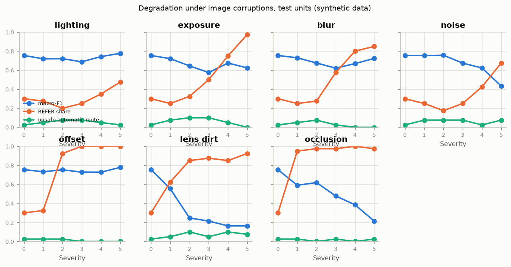
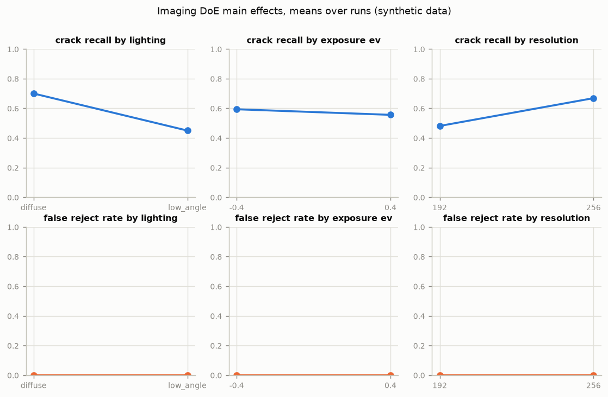

# Validation report

> **Synthetic data.** Every figure below comes from data generated locally by the virtual inspection cell. It shows how the system would be validated, not how it performs on real filters. Thresholds are illustrative targets in `configs/acceptance.yaml`, to be agreed with stakeholders.

- Run: `20261023-062255_demo` (profile `demo`, code `60efad0ef1`, data manifest `93ee938bc98e`)
- Deployed model: concept route `learned_flow_meta` with the routing policy chosen on calibration data
- Rendered by `make validate` from `runs/20261023-062255_demo/metrics.json`

## Acceptance criteria

| ID | Criterion | Target | Measured | Result | Evidence |
|---|---|---|---|---|---|
| AC-01 | Wrongful-scrap rate | <= 0.020 | 0.015 | **PASS** | Decisions on the test split |
| AC-02 | SCRAP capture | >= 0.900 | 0.593 | **FAIL** | Decisions on the test split |
| AC-03 | p95 latency | <= 2.000 | 0.655 | **PASS** | Latency |
| AC-04 | Decision repeatability | >= 0.900 | 0.809 | **FAIL** | Measurement system analysis |
| AC-05 | Conformal coverage | >= 0.870 | 0.913 | **PASS** | Decisions on the test split |
| AC-06 | Graceful degradation | <= 0.100 | 0.075 | **PASS** | Robustness |
| AC-07 | Audit-trail integrity | == yes | yes | **PASS** | Audit trail |
| AC-08 | Inspector workload | <= 0.350 | 0.189 | **PASS** | Decisions on the test split |

6 of 8 criteria pass.

## Evidence

### Decisions on the test split (AC-01, AC-02, AC-05)

- Test units: 254. Wrongful-scrap rate 1.5 %, SCRAP capture (QUARANTINE or REFER) 59.3 %, REFER share 18.9 %.
- Thresholds: quarantine at P(SCRAP) >= 0.70, extended clean at P(REWORK) >= 0.20, conformal level alpha = 0.5, anomaly threshold 3.570.
- Conformal sets at alpha = 0.05: coverage 100.0 % against recorded labels and 100.0 % against the latent truth; mean set size 3.00. ΔP-ratio intervals ± 0.349 cover 98.4 % of recorded values.
- Conformal sets at alpha = 0.1: coverage 91.3 % against recorded labels and 91.7 % against the latent truth; mean set size 1.96. ΔP-ratio intervals ± 0.168 cover 93.3 % of recorded values.

### Robustness (AC-06)

| Corruption | Severity | Macro-F1 | REFER share | Anomaly REFER | Unsafe automatic routes |
|---|---|---|---|---|---|
| none | 0 | 0.755 | 30.0 % | 0.0 % | 2.5 % |
| lighting | 1 | 0.720 | 27.5 % | 0.0 % | 5.0 % |
| lighting | 2 | 0.721 | 20.0 % | 0.0 % | 7.5 % |
| lighting | 3 | 0.688 | 25.0 % | 0.0 % | 7.5 % |
| lighting | 4 | 0.743 | 35.0 % | 0.0 % | 5.0 % |
| lighting | 5 | 0.777 | 47.5 % | 0.0 % | 2.5 % |
| exposure | 1 | 0.721 | 25.0 % | 0.0 % | 7.5 % |
| exposure | 2 | 0.645 | 32.5 % | 0.0 % | 10.0 % |
| exposure | 3 | 0.576 | 50.0 % | 0.0 % | 10.0 % |
| exposure | 4 | 0.675 | 75.0 % | 0.0 % | 5.0 % |
| exposure | 5 | 0.624 | 97.5 % | 0.0 % | 0.0 % |
| blur | 1 | 0.730 | 25.0 % | 0.0 % | 5.0 % |
| blur | 2 | 0.676 | 27.5 % | 0.0 % | 7.5 % |
| blur | 3 | 0.621 | 57.5 % | 0.0 % | 2.5 % |
| blur | 4 | 0.670 | 80.0 % | 0.0 % | 0.0 % |
| blur | 5 | 0.724 | 85.0 % | 0.0 % | 0.0 % |
| noise | 1 | 0.753 | 25.0 % | 0.0 % | 7.5 % |
| noise | 2 | 0.757 | 17.5 % | 0.0 % | 7.5 % |
| noise | 3 | 0.674 | 25.0 % | 0.0 % | 7.5 % |
| noise | 4 | 0.623 | 42.5 % | 0.0 % | 2.5 % |
| noise | 5 | 0.434 | 67.5 % | 0.0 % | 7.5 % |
| offset | 1 | 0.733 | 32.5 % | 0.0 % | 2.5 % |
| offset | 2 | 0.753 | 92.5 % | 0.0 % | 2.5 % |
| offset | 3 | 0.729 | 100.0 % | 0.0 % | 0.0 % |
| offset | 4 | 0.728 | 100.0 % | 0.0 % | 0.0 % |
| offset | 5 | 0.779 | 100.0 % | 0.0 % | 0.0 % |
| lens_dirt | 1 | 0.553 | 62.5 % | 40.0 % | 5.0 % |
| lens_dirt | 2 | 0.247 | 85.0 % | 67.5 % | 10.0 % |
| lens_dirt | 3 | 0.214 | 87.5 % | 70.0 % | 5.0 % |
| lens_dirt | 4 | 0.164 | 85.0 % | 62.5 % | 10.0 % |
| lens_dirt | 5 | 0.164 | 92.5 % | 77.5 % | 7.5 % |
| occlusion | 1 | 0.590 | 95.0 % | 2.5 % | 2.5 % |
| occlusion | 2 | 0.619 | 97.5 % | 0.0 % | 0.0 % |
| occlusion | 3 | 0.478 | 97.5 % | 0.0 % | 2.5 % |
| occlusion | 4 | 0.385 | 100.0 % | 0.0 % | 0.0 % |
| occlusion | 5 | 0.214 | 97.5 % | 0.0 % | 2.5 % |

An unsafe automatic route is a serviceable unit sent to QUARANTINE or a true SCRAP unit released to cleaning without review.

### Domain shift and commissioning

| Stage | Macro-F1 | SCRAP recall | Wrongful scrap | SCRAP capture | REFER share | Units |
|---|---|---|---|---|---|---|
| Main test split | 0.649 | 50.8 % | 1.5 % | 59.3 % | 22.0 % | 254 |
| New line, before commissioning | 0.584 | 52.2 % | 0.0 % | 65.2 % | 19.7 % | 76 |
| New line, after commissioning on 50 units | 0.582 | 52.2 % | 1.9 % | 60.9 % | 15.8 % | 76 |

### Measurement system analysis (AC-04)

Attribute agreement on 47 units, two trials each, against the true outcome:

| Appraiser | Within-appraiser agreement | Agreement with standard (both trials) | Cohen's kappa vs standard |
|---|---|---|---|
| A | 89.4 % | 59.6 % | 0.45 |
| B | 83.0 % | 59.6 % | 0.47 |
| C | 91.5 % | 57.4 % | 0.42 |
| System | 91.5 % | 53.2 % | 0.34 |

- All appraisers agree with each other on 40.4 % of units; Fleiss' kappa (first trials) 0.58.
- System route repeatability across re-imaging: 80.9 %.

Gauge R&R on the predicted ΔP ratio (10 units x 3 stations x 3 trials): %GRR 6.8 % of study variation (repeatability 6.2 %, reproducibility 2.9 %), ndc = 20. AIAG guidance: under 10 % acceptable, 10 to 30 % may be acceptable depending on the application, over 30 % unacceptable; ndc of at least 5.

### Imaging DoE (Should)

Recommended set-up: lighting `diffuse`, exposure -0.4 EV, resolution 256 px (crack recall 80.0 %, false-reject rate 0.0 %). The resolution effect includes a train/test mismatch because the perception model was trained only at the higher resolution.

| Term | Effect on crack recall | p | Effect on false-reject rate | p |
|---|---|---|---|---|
| lighting | -0.250 | 0.000 | 0.000 | n/a |
| exposure_ev | -0.038 | 0.122 | 0.000 | n/a |
| lighting:exposure_ev | -0.013 | 0.580 | 0.000 | n/a |
| resolution | 0.188 | 0.000 | 0.000 | n/a |
| lighting:resolution | -0.013 | 0.580 | 0.000 | n/a |
| exposure_ev:resolution | 0.025 | 0.282 | 0.000 | n/a |
| lighting:exposure_ev:resolution | -0.000 | 1.000 | 0.000 | n/a |

### Latency (AC-03, Should)

| Path | p50 (s) | p95 (s) | Units |
|---|---|---|---|
| mps (PyTorch) | 0.134 | 0.151 | 15 |
| cpu (PyTorch) | 0.512 | 0.739 | 15 |
| cpu (ONNX Runtime U-Net) | 0.555 | 0.655 | 15 |

ONNX export of the U-Net: largest output difference from PyTorch 0.000002. Timings were taken on the development laptop under heavy memory pressure from other applications and are an upper bound for this hardware.

### Audit trail (AC-07)

A fresh trail of 20 records verified clean: yes. After altering two records directly in the database: tampering detected: yes (record 2: content altered).

Campaign run time: robustness 133.9 s; domain_shift 53.0 s; msa 35.4 s; doe 39.7 s; latency 24.5 s.
